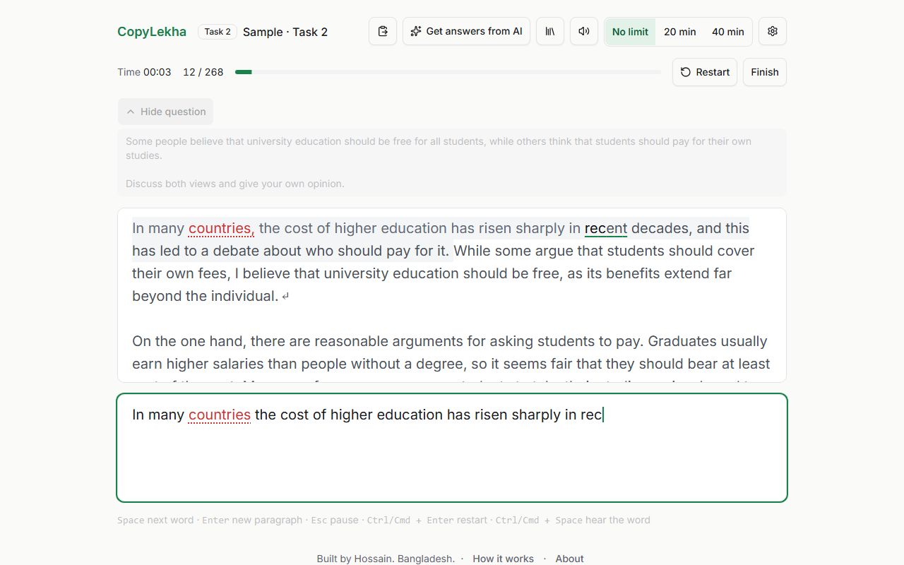

# CopyLekha

**CopyLekha: copywork practice for IELTS Academic Writing.**

Copywork means retyping a well-written text word by word. Typing a Band 8.5+ model answer this way helps you take in its structure, grammar and collocations. CopyLekha gives you the model answer above and a typing box below, catches every mistake as you type, and shows how you did at the end.

The name is "Copy" plus the Bangla word "লেখা" (lekha, "writing").

**Live app:** [copylekha.vercel.app](https://copylekha.vercel.app)



## Features

- **Copywork typing:** the word to type next is underlined. Every spelling, capital letter and punctuation difference is caught as you type, and a wrong word turns red with a dotted underline.
- **Answers from your own AI chat:** copy a ready prompt into ChatGPT, Claude or Gemini, then paste the whole reply. CopyLekha splits it into Task 1 and Task 2, each with its question, answer and vocabulary. A plain answer pasted by hand works too.
- **Results:** speed (WPM), accuracy, your mistakes by kind (spelling, capital letters, punctuation), the answer's vocabulary, and a comparison with your last attempt on the same answer.
- **Sound:** each word can be read aloud with your browser's own voices.
- **Timer:** no limit, 20 minutes or 40 minutes, like the real test.
- **Library:** your answers grouped by day, with rename and delete.
- **Light and dark themes**, and a text size you can change.
- **Private:** your answers and progress stay in your browser. There is no account and no server.

CopyLekha is made for a laptop or desktop with a physical keyboard. Phones can open it, but typing on them is not a goal.

## How to use it

1. Open the app. A sample answer is loaded, so you can start typing at once.
2. To get your own answers, click **Get answers from AI**. Copy the prompt into your AI chat (or click **Open in ChatGPT**), then write **Start Day 1**. The next day, write **Start Day 2** in the same chat, and so on.
3. Copy the whole reply, click **Paste** in CopyLekha and paste it. Check the preview and click **Save and start**.
4. Type the answer in the lower box. Your result appears when you type the last word.

Shortcuts while typing: **Space** next word, **Enter** new paragraph, **Esc** pause, **Ctrl/Cmd + Enter** restart, **Ctrl/Cmd + Space** hear the word again.

The full prompt is in the app and in `frontend/src/lib/ai-prompt.ts`; the product's behaviour is specified in [docs/PRD.md](docs/PRD.md).

## Privacy

Everything you paste and type stays in your browser's local storage. Nothing you type or paste is ever sent anywhere. The public site counts anonymous usage with [Umami](https://umami.is) (no cookies, no personal data), such as "a practice was started". Builds without an Umami website id, including local runs and forks, send nothing.

## Run it locally

You need [Node.js](https://nodejs.org) 26 and npm. The app lives in `frontend/`.

```
cd frontend
nvm use 26
npm install
npm run dev
```

Then open http://localhost:3000. No environment variable is needed; the optional ones are listed in `frontend/.env.example`.

Other commands, all run in `frontend/`:

```
npm run build          # static export to out/
npm run preview        # serve out/ to check the real build
npm run check          # lint and format check
npm run typecheck      # TypeScript
npm test               # unit and component tests (Vitest)
npm run test:e2e       # end-to-end flows with accessibility checks (Playwright)
```

Built with Next.js (static export), TypeScript, Tailwind CSS and shadcn/ui.

## Contributing

Bug reports, ideas and pull requests are welcome. See [CONTRIBUTING.md](CONTRIBUTING.md).

## Licence

[MIT](LICENSE). Built by Hossain, Bangladesh: [GitHub](https://github.com/hossain101199) · [LinkedIn](https://www.linkedin.com/in/hossain1011/).

"IELTS" is a registered trademark of the British Council, IDP: IELTS Australia and Cambridge University Press & Assessment. CopyLekha is not connected with or endorsed by them.
